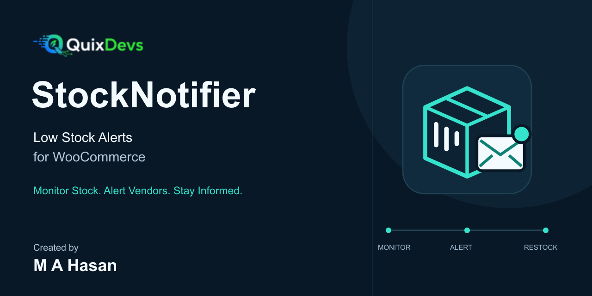
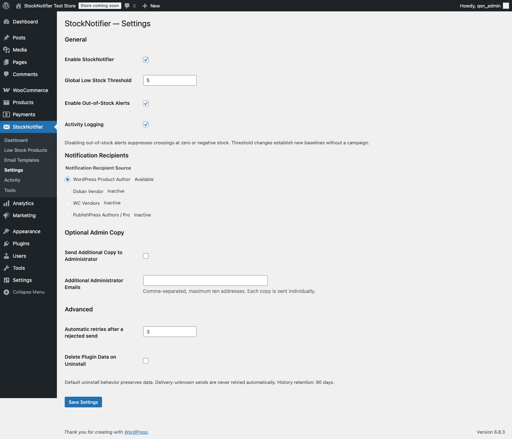
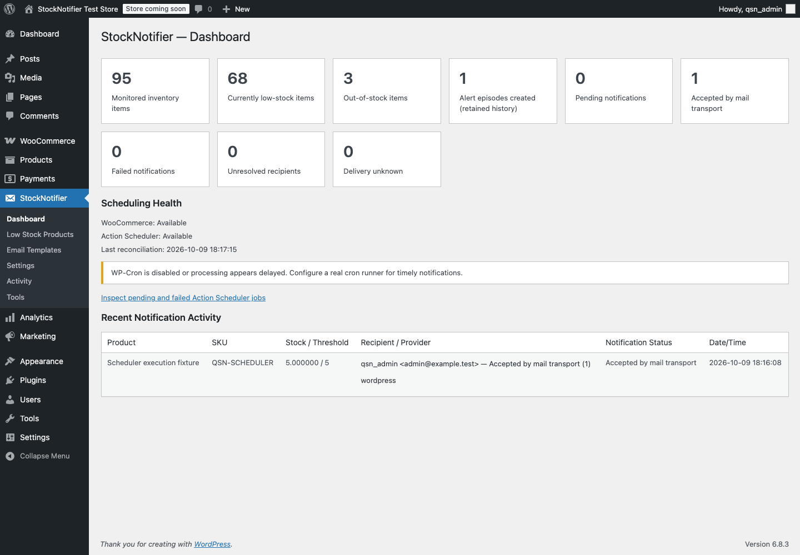
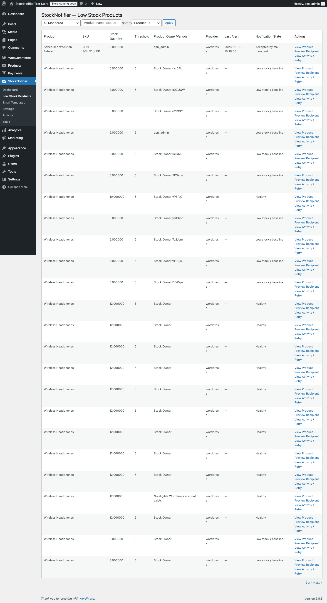
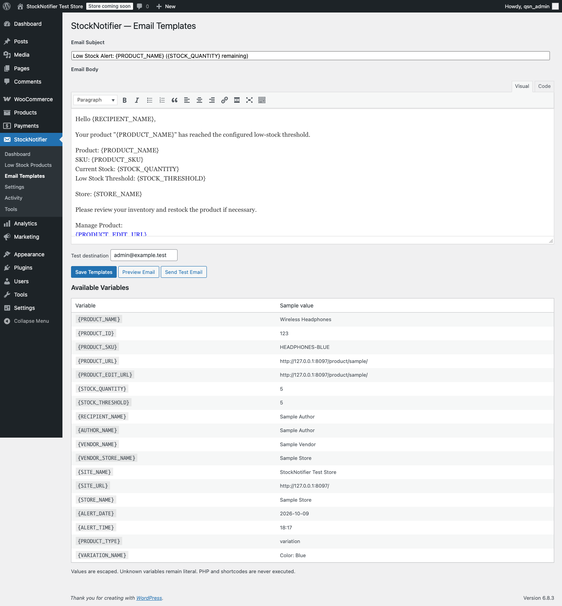
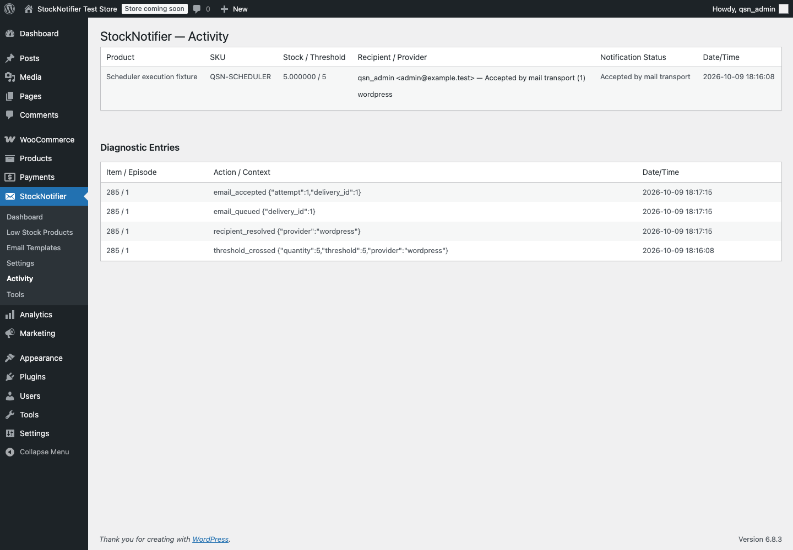
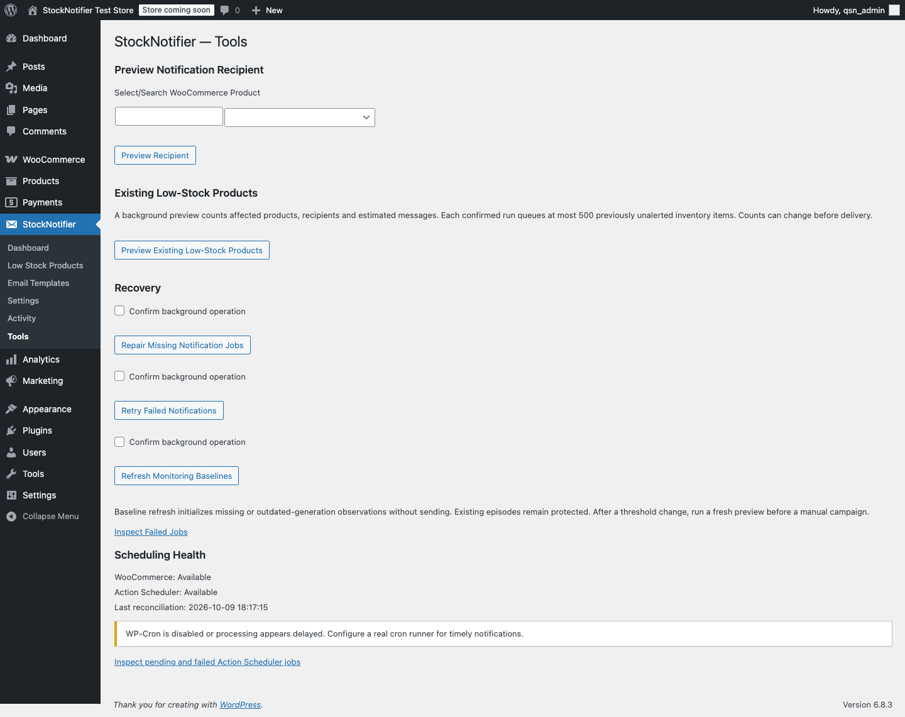

# QuixDevs StockNotifier



**Low Stock Alerts for WooCommerce**  
Monitor Stock. Alert Vendors. Stay Informed.

A free, open-source **WooCommerce low-stock notification plugin** for stores that need to alert product authors or marketplace vendors when managed inventory runs low. Choose one recipient system, set a whole-number threshold, and customize the email from native WordPress screens.

StockNotifier creates one alert per threshold crossing and sends messages in the background. Restocking above the threshold rearms the next alert, so repeated low-stock updates do not flood inboxes.

Version **1.0.0** · GPL-2.0-or-later · Published by **QuixDevs**

**[Installation](#installation)** · [Quick start](#quick-start) · [Recipient compatibility](#recipient-compatibility) · [Screenshots](#screenshots) · [Developer docs](#developer-documentation-and-testing)



*Set your threshold and recipient policy in StockNotifier → Settings. Genuine demo-store capture with synthetic data.*

## Features

- One global threshold, default **5**, with strict whole-number validation in the browser and on the server.
- Explicit recipient radio selection: WordPress Product Author, Dokan, WC Vendors, or PublishPress Authors / Pro.
- Simple products, parent-managed variable inventory, and independently managed variations.
- One durable episode per crossing, individual recipient records, bounded retries, and safe recovery.
- Native WordPress rich-text templates, 18 variables, synthetic previews, and administrator test emails.
- Private dashboard, searchable inventory, activity, recipient preview, and confirmed background tools.
- No stock, price, status, order, or vendor-ownership changes. No telemetry or external service dependency.

## Requirements

| Component | Declared minimum | Locally verified |
| --- | --- | --- |
| WordPress | 6.8 | 6.8.3 |
| WooCommerce | 10.0, installed and active | 10.0.4 |
| PHP | 8.1 | 8.4.13 |
| Database | MySQL/MariaDB with InnoDB, connection-owned `GET_LOCK()` and a stable writer connection | MySQL 8.0.46 |

Action Scheduler is supplied by WooCommerce. Minimum requirements describe the intended API baseline; they are not separate test claims. No optional provider plugin is needed in WordPress author mode. Activate individually per site; network activation is unsupported.

## Installation

**WooCommerce must already be installed and active. No Composer or command-line tools are needed on your store.**

When a public release is available, open this repository's **Releases** section and download **`quixdevs-stocknotifier.zip`** under the release's Assets. Use that installable asset rather than GitHub's automatically generated source archives.

If no release is listed, the public installation ZIP has not been published. Maintainers can build it locally with `python3 bin/build-release.py` and follow the [publishing checklist](docs/github-publishing-checklist.md). The command creates the installable ZIP beside the repository folder without requiring Composer.

1. In WordPress Admin, open **Plugins → Add Plugin → Upload Plugin**.
2. Choose `quixdevs-stocknotifier.zip`, select **Install Now**, then **Activate Plugin**.
3. Open **StockNotifier → Dashboard** and check scheduling health.

## Quick start

1. Open **StockNotifier → Settings** and enable StockNotifier.
2. Set **Global Low Stock Threshold**, for example `5`.
3. Choose exactly one **Notification Recipient Source** and save.
4. Use **Tools → Preview Notification Recipient** to confirm ownership and the intended destination for a product.
5. Preview your template and send an explicitly labeled test message from **Email Templates**.
6. Review **Low Stock Products**, **Activity** and scheduling health after a genuine threshold crossing.

Initial baselines build in bounded background batches; activation does not email existing low-stock products. Pre-update observation preserves a first genuine crossing even before its background baseline is visited. To alert an existing low-stock catalog, use the separate preview and confirmation tool.

## Threshold examples

With threshold **5**:

| Inventory change | Result |
|---|---|
| 12 → 8 | Healthy; no message |
| 8 → 5 | Create one asynchronous alert episode |
| 5 → 4 → 2 | Same low episode; no duplicate alert |
| 2 → 10 | Rearm |
| 10 → 5 | New episode |

Use **0** for out-of-stock-only alerts. Enable Out-of-Stock Alerts must remain checked for zero/negative-stock messages. Unchecked, crossings at zero or negative quantities are suppressed. Backorders use the actual numeric quantity. Unmanaged inventory and the “in stock” label never imply zero inventory.

Enter ASCII digits only: `0`, `5`, `100`, up to `2147483647`. Letters, spaces, signs, fractions, decimals, commas, exponents, empty input and overflow are rejected. A rejected save preserves the previous integer and notification state. Leading zeroes are accepted and normalized after validation.

Changing the threshold establishes a new monitoring generation without a mass campaign. Refresh baselines and preview existing low stock in Tools if you want to review the new configuration.

## Recipient compatibility

Exactly one provider applies globally. Other installed integrations never act as alternate recipient sources. If a selected provider disappears, its setting remains selected and affected work pauses; there is no administrator fallback.

| Provider | Resolution | Actual verification |
|---|---|---|
| WordPress Product Author | Product `post_author` → verified WP_User email | WordPress 6.8.3 / WooCommerce 10.0.4 integration suite |
| Dokan Vendor | Public product-vendor API, matching owner, seller excluding staff, enabled selling | Dokan Lite 5.3.0 installed API tests |
| WC Vendors | Public vendor-from-product API, matching owner, vendor eligibility | WC Vendors Marketplace 2.7.2.2 installed API tests |
| PublishPress Authors | Explicit product author assignments, ordered registered accounts only | PublishPress Authors 4.17.0 installed API tests |
| Premium editions | Same compatible public API surface where available | **Not tested:** Dokan Pro, WC Vendors Pro, PublishPress Authors Pro |

PublishPress requires the **product** post type enabled. Primary means the first assigned author in API order; if that author is a guest, it is skipped without silently selecting a secondary author. All Assigned Registered Authors sends separate messages to validated user accounts and deduplicates email addresses. Guest contact fields are never email destinations.

Variations resolve ownership from their parent. Shared parent stock has one monitoring identity; independent variation stock has its own identity and variation details. Ownership or mailbox changes invalidate a queued recipient snapshot rather than redirecting its message to a different person.

## Admin screens

| Screen | Purpose |
|---|---|
| Dashboard | Inventory and recipient-outcome counts, scheduling health and recent activity |
| Low Stock Products | Paginated search by product name, SKU or ID; state filters and sorting |
| Email Templates | Subject, native rich-text editor, variable reference, preview, test email |
| Settings | General settings, explicit provider, PublishPress policy, individual admin copies, retries, uninstall |
| Activity | Episode and individual recipient outcomes, diagnostic entries, confirmed failed-send retry |
| Tools | Recipient preview, existing-stock preview/campaign, job repair, retries, baseline refresh, diagnostics |

All screens and email actions require `manage_options`; ordinary authors, shop managers and vendors do not inherit access.

## Email templates

Default subject:

```text
Low Stock Alert: {PRODUCT_NAME} ({STOCK_QUANTITY} remaining)
```

The default body greets the recipient, identifies the product and SKU, shows quantity and threshold, and provides an accessible destination to review inventory. Store and site names are included. Rich HTML is sanitized and dynamic values escaped; PHP and shortcodes are not executed. Unknown variables remain literal.

Available variables:

```text
{PRODUCT_NAME} {PRODUCT_ID} {PRODUCT_SKU} {PRODUCT_URL}
{PRODUCT_EDIT_URL} {STOCK_QUANTITY} {STOCK_THRESHOLD}
{RECIPIENT_NAME} {AUTHOR_NAME} {VENDOR_NAME} {VENDOR_STORE_NAME}
{SITE_NAME} {SITE_URL} {STORE_NAME} {ALERT_DATE} {ALERT_TIME}
{PRODUCT_TYPE} {VARIATION_NAME}
```

WordPress editing links check the recipient's capability. Dokan uses the vendor's product dashboard list because a worker-generated session nonce would be unusable in a vendor email. WC Vendors uses its supported editor URL. Public product URLs are the safe fallback. Each email has one destination, including optional administrator copies; no recipient list is exposed through CC.

Test emails use synthetic values, are labeled **TEST EMAIL**, run through Action Scheduler, and do not change stock or monitoring eligibility. A successful transport response means **accepted by mail transport**, not inbox delivery.

## Recovery and duplicate prevention

Stock hooks create a unique item/episode record. Recipient jobs use stable identifiers, connection locks, and persistent send claims. A restock, disabled stock management, obsolete configuration or changed ownership prevents pending mail from being sent.

A rejected transport response is retried up to three times by default (configurable 0–5), with bounded backoff. A crash or exception after transport invocation is **Delivery unknown** and is never retried automatically. Exactly-once delivery is not promised.

Tools can repair missing queued work and retry explicitly failed sends after confirmation. Existing-stock campaigns require a completed preview showing affected products, resolved recipients, unresolved products and estimated messages. Each confirmed run covers at most 500 previously unalerted inventory items. Completed episodes are not resent by changing the provider or running this tool.

Recovery checks at most 100 queue records per batch and rotates across the backlog. Unresolved episodes back off for an hour. A catalog pass visits 100 product IDs per minute, at most one completed pass per day. Diagnostic previews never send mail.

## Cron and known limitations

Action Scheduler depends on a functioning runner and usually WP-Cron. Low-traffic sites can delay processing; use a real server cron or WooCommerce's supported Scheduler runner where appropriate. Inspect Scheduler health and failed jobs in Tools.

- Tested runtime: PHP 8.4.13, MySQL 8.0.46, WordPress 6.8.3, WooCommerce 10.0.4. Minimum supported versions are requirements, not claims of separate test runs.
- Premium integrations, a complete vendor-dashboard editing journey, non-Chromium browsers, large-store load benchmarks, multisite network activation, and real SMTP/inbox delivery remain unverified.
- Unsupported direct stock SQL changes can be recovered only if a prior observation exists. A transient crossing and restock entirely between observations cannot be reconstructed.
- The manual existing-stock tool intentionally excludes items with a prior episode. Future restock/crossing alerts remain eligible.
- Only one manual bulk tool runs at a time. Expired runs cancel safely; start a fresh preview.
- Terminal history is pruned after 90 days in bounded batches. Unresolved and ambiguous deliveries remain for review. WooCommerce source logs follow WooCommerce's retention controls.
- SQLite is unsupported because connection-owned MySQL/MariaDB locks are required.

Default uninstall behavior preserves all plugin data. Opt-in deletion removes only StockNotifier-owned tables, options and scheduled processing; WooCommerce inventory and unrelated logs are untouched.

## Screenshots

Settings are shown above. These additional screenshots show the working local plugin with synthetic products, accounts and destinations. [Capture details](docs/screenshots/README.md).

### Dashboard — inventory, delivery outcomes and scheduler health



*Review monitored inventory and individual notification outcomes alongside queue health.*

### Low Stock Products — searchable inventory and notification state



*Search by product name, SKU or ID and filter inventory by monitoring or notification state.*

### Email Templates — rich-text editing and safe previews



*Customize the message, preview synthetic values and queue an administrator-only test email.*

### Activity — individual results and diagnostic history



*Transport acceptance, rejected sends and ambiguous outcomes remain distinct.*

### Tools — recipient preview and confirmed recovery



*Preview recipients without sending mail; review counts before explicitly confirming bulk work.*

[Mobile settings capture](docs/screenshots/settings-mobile.png) · [WordPress upload verification](docs/screenshots/installation.png)

## FAQ

**Does this replace WooCommerce stock emails?** No. Its independent episode records do not change native notification behavior.

**Will enabling the plugin notify the existing catalog?** No. Use the confirmed existing-stock tool when you want a manual campaign.

**Can I select multiple marketplaces or automatic detection?** No. v1.0.0 uses exactly one explicit recipient provider.

**What happens if an email fails?** Each destination has its own result. Rejected sends have bounded retries; ambiguous sends require review and are never retried automatically.

**Does wp_mail returning true prove delivery?** No. It reports transport acceptance only.

## Developer documentation and testing

Recorded verification includes **35 unit tests / 51 assertions**, installed free-provider API checks, WordPress/WooCommerce integration runs, independent-process concurrency, real Chrome input checks, PHPCS, Plugin Check and native ZIP upload/activation. Expected provider-dependent skips and untested configurations are documented; no green remote-CI status is claimed.

Start with [architecture](docs/architecture.md), [stock monitoring](docs/stock-monitoring.md), [recipient resolution](docs/recipient-resolution.md), [email templates](docs/email-templates.md), and [testing](docs/testing.md). See the [implementation report](docs/implementation-report.md) and [release checklist](docs/release-checklist.md) for actual results and remaining verification.

```sh
composer install
composer test
composer lint
QSN_WP_ROOT=/path/to/isolated/qsn-tests/wordpress vendor/bin/phpunit -c phpunit-integration.xml.dist
python3 bin/build-release.py
```

Production autoloading is bundled. Development dependencies, tests, CI, local configuration and presentation assets are excluded from the installable ZIP. Nothing is published or deployed by the build script.

- [GitHub listing and topics](docs/github-listing.md), [release notes](docs/github-release-notes.md) and [publishing checklist](docs/github-publishing-checklist.md)
- [Editable branding and exports](docs/branding/README.md), [real screenshot details](docs/screenshots/README.md) and [WordPress.org asset handoff](wordpress-org-assets/README.md)
- [Contributing](CONTRIBUTING.md), [security reporting](SECURITY.md) and [changelog](CHANGELOG.md)

## License

Copyright © 2026 QuixDevs. Licensed under [GPL-2.0-or-later](LICENSE).

## 👨‍💻 Developer & Creator

**[Md Abu Hasan (M A Hasan)](https://hasan.online/)**

Full-Stack Software Engineer with **10+ years of experience** building web applications, SaaS platforms, WordPress and WooCommerce plugins, and hybrid mobile applications.

**Technical Expertise:** PHP, Laravel, WordPress, WooCommerce, Ionic Angular, TypeScript, REST APIs, and AI integrations.

- 🌐 **Portfolio & About Me:** [hasan.online](https://hasan.online/)
- 🎓 **Udemy Instructor:** [View Profile](https://www.udemy.com/user/m-a-hasan-2/)
- 🛠️ **Envato Author:** [View Portfolio](https://themeforest.net/user/hasanonline)
- ✍️ **Technical Blog:** [blog.hasan.online](https://blog.hasan.online)

## 🏢 Published & Maintained by

**QuixDevs**

QuixDevs StockNotifier is developed and maintained under the **QuixDevs** brand as free, open-source software.

**Copyright © 2026 QuixDevs.**

Licensed under [GPL-2.0-or-later](LICENSE). QuixDevs StockNotifier is an independent plugin and is not officially endorsed by WooCommerce.
